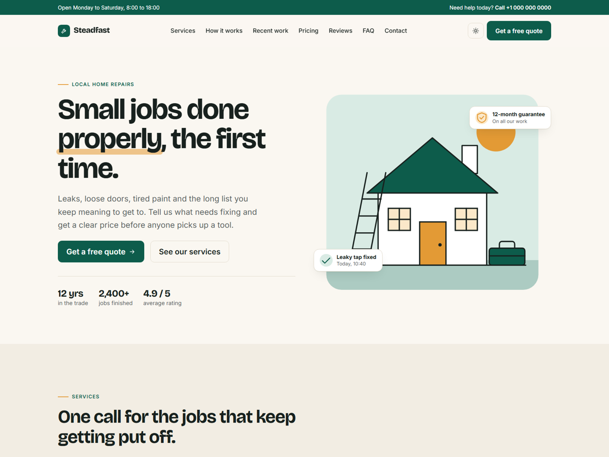

# Steadfast: a Bludit theme for small service businesses

A one-page theme for tradespeople, repair shops, cleaners, gardeners and anyone else who sells their time locally. All the home page text lives in one data file.

**[Live demo](https://ello-lithuania.github.io/steadfast-bootstrap-template/)**

## Features

- Home page sections for hero, services, process, recent work, pricing, reviews, FAQ, contact and a call to action
- Every section is optional: delete its key and it disappears from the page
- Light and dark modes that follow the system setting, with a manual toggle
- Fully responsive, tested down to 375 px
- Regular Bludit pages and posts use a matching layout
- Contact form with browser validation that posts to any form service or backend
- Bootstrap 5.3 included locally, no jQuery

## Installation

1. [Download the ZIP](https://github.com/ello-lithuania/steadfast-bludit/archive/refs/heads/main.zip) and unpack it.
2. Rename the folder to `steadfast` and copy it to `bl-themes/` in your Bludit site.
3. In the admin area, open **Settings > Themes** and activate Steadfast.

Tested with Bludit 3.22.

## Editing the home page

Everything is in `data/site.json` inside the theme folder:

| Key | What it controls |
|---|---|
| `brand`, `brand_icon`, `tagline` | Name, icon and footer text |
| `phone`, `phone_href`, `email` | Contact details, used in the header, contact section and footer |
| `nav`, `footer_columns` | Navigation links |
| `hero`, `services`, `process`, `work`, `pricing`, `reviews`, `faq`, `contact`, `cta` | Page sections |

The page title and description come from your Bludit site settings. If you set a static page as the home page in Bludit, that page is shown instead of these sections.

The reviews in the demo are placeholder text. Replace them with real reviews from your own customers.

Available icons: `wrench`, `bolt`, `drop`, `brush`, `door`, `leaf`, `check`, `phone`, `mail`, `pin`, `clock`, `shield` and `star`.

To use photos instead of illustrations, set `image` and `image_alt` on `hero` or on an item in `work.items`, using the full address of the image.

## Contact form

Without any setup, the form only validates in the browser and shows a demo message. Set `contact.form_action` to your form service or backend to start receiving messages.

## Colours and fonts

The colours are CSS variables named `--sf-*` at the top of `css/style.css`, one set for light mode and one for dark mode. Fonts (Bricolage Grotesque and Inter) load from Google Fonts in `index.php`.

## Credits

Designed and built by [KokybiskaSvetaine.lt](https://kokybiskasvetaine.lt/). The footer credit can be turned off with `"credit": false`.

Uses [Bootstrap](https://getbootstrap.com/) (MIT), [Bricolage Grotesque](https://fonts.google.com/specimen/Bricolage+Grotesque) and [Inter](https://fonts.google.com/specimen/Inter) (SIL Open Font License).

## Licence

MIT. See [LICENSE](LICENSE).
